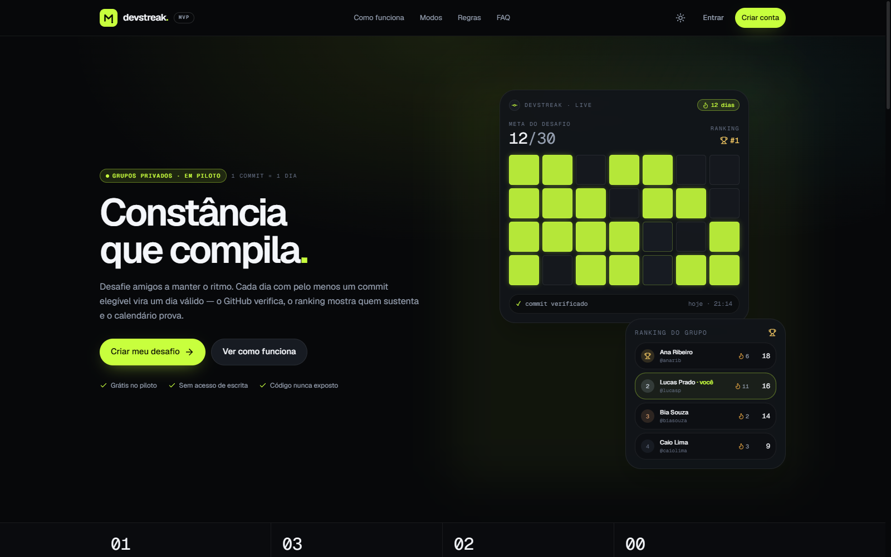
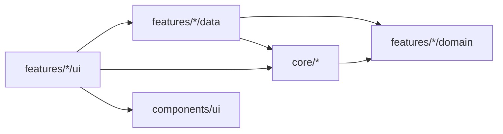
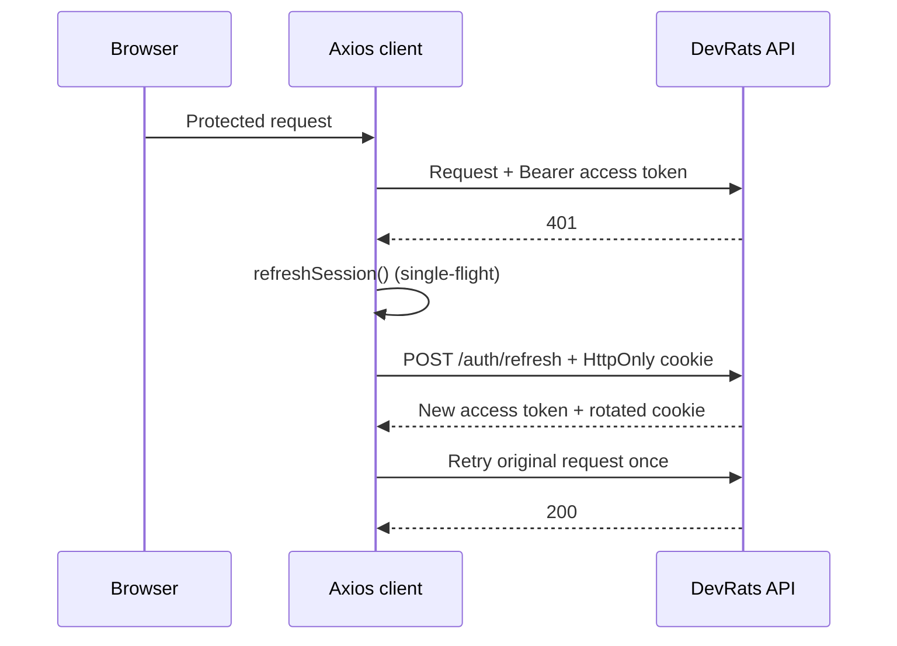

<div align="center">

# DevRats Web 🎯

**React frontend for DevRats — private consistency challenges for developers, with automatic GitHub commit verification, rankings, streaks, and a valid-day calendar.**

[](https://github.com/felipevenas/webapp-dev-rats/actions/workflows/ci.yml)
[](https://react.dev/)
[](https://www.typescriptlang.org/)
[](https://vite.dev/)
[](https://tailwindcss.com/)
[](https://vitest.dev/)
[](https://oxc.rs/)
[](#governance)
[](LICENSE)

<br />

<p align="center">
  <a href="#overview"><b>Overview</b></a> •
  <a href="#quick-start"><b>Quick Start</b></a> •
  <a href="#configuration"><b>Configuration</b></a> •
  <a href="#architecture"><b>Architecture</b></a> •
  <a href="#authentication-and-session-security"><b>Session</b></a> •
  <a href="#routes"><b>Routes</b></a> •
  <a href="#testing"><b>Testing</b></a> •
  <a href="#known-limitations-mvp-trade-offs"><b>Limitations</b></a> •
  <a href="#governance"><b>Governance</b></a>
</p>

</div>

---

> **Backend repository:** [felipevenas/api-dev-rats](https://github.com/felipevenas/api-dev-rats) ·
> **Live product:** [devrats.app](https://devrats.app) ·
> **Public API:** [api.devrats.app](https://api.devrats.app)

## Overview

DevRats is a constancy platform for developers: private groups create challenges, GitHub commits are verified automatically, and the group follows rankings, streaks, and a calendar of valid days until a winner is declared.

This repository is the **React single-page application**. It consumes the Spring Boot API in [`api-dev-rats`](https://github.com/felipevenas/api-dev-rats) and implements the navigable MVP described in [`docs/PRD-MVD.md`](docs/PRD-MVD.md).



> Public landing page in the dark theme. Authenticated screens require the API to be running; all flows are listed under [Routes](#routes).

### Product surfaces

- Public landing page, authentication, and public invite acceptance.
- Onboarding checklist for connecting GitHub and creating the first challenge.
- Dashboard, challenge list, and a five-step creation wizard.
- Group overview, leaderboard, activity calendar, feed, and final result.
- Friends, public profiles, presence, notifications, and real-time chat.
- Profile, preferences, LGPD export/deletion, and GitHub integration settings.

## Quick Start

### Prerequisites

- **Node.js >= 22.12** (validated with Node 24).
- **npm >= 10**.
- The Spring Boot API (`api-dev-rats`) and PostgreSQL running for authenticated flows.

### 1. Install dependencies

```powershell
git clone https://github.com/felipevenas/webapp-dev-rats.git
cd webapp-dev-rats
npm install
Copy-Item .env.example .env.local
```

### 2. Start the frontend

```powershell
npm run dev
```

The app starts at **http://localhost:5174**. Port `5173` is intentionally avoided because another local project commonly occupies it.

### 3. Start the API

In a separate terminal:

```powershell
cd ../api-dev-rats
$env:SPRING_PROFILES_ACTIVE = 'local'
$env:APP_FRONTEND_URL = 'http://localhost:5174'
$env:APP_CORS_ALLOWED_ORIGINS = 'http://localhost:5173,http://localhost:5174'
.\mvnw.cmd spring-boot:run
```

The backend must receive `APP_FRONTEND_URL=http://localhost:5174` because GitHub OAuth redirects back to the frontend origin. On macOS/Linux, use `export` instead of `$env:`.

### 4. Verify the quality gates

```powershell
npm run lint
npm run typecheck
npm test
npm run build
```

## Configuration

Vite exposes only variables prefixed with `VITE_`. **Anything in `VITE_*` is public and included in the client bundle.** Never put API secrets, GitHub App credentials, or private keys here.

| Variable | Required | Default / example | Description |
|---|---|---|---|
| `VITE_API_BASE_URL` | No | empty → `/api/v1` | REST base URL. Empty keeps the app same-origin and lets the Vite proxy handle `/api` in development. In production it may be an absolute URL, e.g. `https://api.devrats.app/api/v1`. |
| `VITE_WS_URL` | No | derived | Explicit WebSocket URL, e.g. `wss://api.devrats.app/ws`. Usually required in production because Vercel cannot upgrade WebSocket connections; the code falls back to `wss://api.devrats.app/ws` on the official domain. |
| `VITE_APP_NAME` | No | `DevRats` | Reserved; currently not read by the app. The app name is fixed in `src/core/config/env.ts`. |
| `VITE_PROXY_API_TARGET` | No | `http://localhost:8080` | Dev proxy target for `/api`. Used only when `VITE_API_BASE_URL` is empty. |
| `VITE_PROXY_WS_TARGET` | No | `ws://localhost:8080` | Dev proxy target for `/ws`. Used only when `VITE_WS_URL` is empty. |
| `VITE_PROXY_ORIGIN` | No | `http://localhost:5174` | `Origin` header injected by the dev proxy so the API accepts refresh/logout requests. |

### How the development proxy works

In development, Vite proxies `/api` and `/ws` to `http://localhost:8080`. This keeps the `HttpOnly` refresh cookie **same-origin** and removes the need for browser CORS during local development.

To point the dev server at another API without rebuilding:

```env
VITE_PROXY_API_TARGET=https://api.devrats.app
VITE_PROXY_WS_TARGET=wss://api.devrats.app
VITE_PROXY_ORIGIN=https://devrats.app
```

Clear `VITE_API_BASE_URL` and `VITE_WS_URL` first; an absolute value in either variable makes the frontend connect directly and bypass the corresponding proxy.

## Architecture

The app is organized **feature by feature**. Each feature owns its domain rules, server-state access, and presentation:

```text
src/
├── app/              providers, router, root layout, query client
├── components/
│   ├── brand/        logo, GitHub mark, streak visual
│   ├── feedback/     splash, toaster, navigation progress
│   ├── layout/       AppShell, sidebar, bottom nav, page header
│   └── ui/           design system (buttons, cards, modals, fields, ring…)
├── core/
│   ├── auth/         in-memory session, route guards
│   ├── config/       environment, query keys
│   ├── http/         axios, single-flight refresh, RFC 9457 parser
│   ├── lib/          dates/timezone, formatting, theme, utilities
│   └── types/        API contracts and UI types
├── features/
│   ├── auth/         login, register, password recovery, schemas
│   ├── challenges/   creation wizard, rules, status
│   ├── chat/         conversations, thread, composer, voice, attachments, STOMP
│   ├── dashboard/    panel and challenge cards
│   ├── errors/       403, 404, error boundary
│   ├── friends/      search, requests, presence
│   ├── github/       integration and repositories
│   ├── groups/       group detail, ranking, settings, invites
│   ├── invites/      public invite page
│   ├── landing/      public landing page
│   ├── legal/        terms and privacy
│   ├── notifications/ alert center
│   ├── onboarding/   connection checklist
│   ├── profile/      profile, preferences, export, deletion
│   ├── progress/     leaderboard, calendar, feed, result
│   └── users/        public profile
├── styles/           tokens, base styles, utilities
└── tests/            shared test setup and cross-cutting tests
```

Each feature uses three layers:

| Layer | Responsibility | Must not |
|---|---|---|
| `domain` | Pure types, schemas, and business rules | Import React, axios, hooks, or browser APIs |
| `data` | API clients, TanStack Query hooks, query keys, socket providers | Contain visual markup |
| `ui` | Pages and presentational components | Call APIs directly or duplicate domain rules |

### Unidirectional dependency flow



The rule is **`ui → data → domain`**. Dependencies never point back: `domain` stays pure, `data` knows how to fetch and cache, and `ui` renders states. Shared infrastructure (HTTP client, auth session, date helpers, design system) lives in `core` and `components`.

### Server state and forms

- **TanStack Query** owns server state, caching, retries, and invalidation.
- **React Hook Form + Zod** validate forms and mirror backend rules (password policy, challenge dates, target limits).
- **React Router 7** lazy-loads every route, keeping the initial bundle focused on the landing and auth flows.
- **STOMP** delivers live chat events; REST remains the source of truth for writes.

## Authentication and Session Security

Session handling is intentionally strict and is one of the most important parts of this codebase.

### Token placement

| Token | Storage | Lifetime | Readable by JavaScript? |
|---|---|---|---|
| Access token (JWT) | **Memory only** (`tokenStore` module variable) | Short (`PT15M` by default) | Yes, but never persisted |
| Refresh token | **`HttpOnly` cookie** set by the API | Long (`P30D` by default) | **No** |

The refresh cookie is named `ds_refresh`, uses `HttpOnly`, `SameSite=Strict`, `Secure` in production, and is scoped to `/api/v1/auth`. No token is written to `localStorage` or `sessionStorage`.

### Single-flight refresh with Axios

The Axios client in [`src/core/http/api-client.ts`](src/core/http/api-client.ts) implements a **single-flight** refresh:

1. A module-level `refreshPromise` is reused while a refresh is in progress.
2. Any `401` on a protected request triggers `refreshSession()`.
3. **Concurrent `401`s share the same refresh request** instead of rotating the cookie multiple times.
4. After a successful refresh, the original request is retried **once** with the new access token.
5. If refresh fails, the token store is cleared and the auth provider transitions to `anonymous`.



### Boot and route protection

- On boot, `AuthProvider` calls `refreshSession()`. If the cookie is valid, it fetches `/me` and restores the session without a full login.
- `RequireAuth` preserves the attempted path in `?next=` and redirects anonymous users to `/login`.
- `RequireAnonymous` redirects authenticated users away from auth screens.
- The `next` parameter is accepted only when it starts with `/` and not `//`, preventing open redirects.
- Logout always clears the local session, even if the API is unreachable.

## Routes

| Route | Screen |
|---|---|
| `/` | Public landing page |
| `/login`, `/register`, `/forgot-password`, `/reset-password` | Authentication |
| `/onboarding` | Connect GitHub and create the first challenge |
| `/invites/:token` | Public invite preview and acceptance |
| `/app` | Dashboard |
| `/app/challenges` | Challenge list and filters |
| `/app/groups/new` | Creation wizard (group → rules → window → repositories → review) |
| `/app/groups/:groupId` | Challenge: overview, leaderboard, calendar, and activity |
| `/app/groups/:groupId/settings` | Group, members, invites, and danger zone |
| `/app/notifications` | Alert center |
| `/app/friends` | Friends: search, requests, and presence |
| `/app/chat` | Conversations: list, search, and new conversation |
| `/app/chat/:conversationId` | Private or group thread with text, image, voice, and document |
| `/app/users/:username` | Public profile and friendship actions |
| `/app/profile` | Profile, preferences, and data controls |
| `/app/settings/integrations` | GitHub integration and repositories |
| `/termos`, `/privacidade` | Legal documents |
| `/403`, `*` | Forbidden and not-found states |

## Responsiveness

Tested with Playwright at **320, 360, 390, 768, 1024, 1280, and 1440 px**, in both light and dark themes, across landing, authentication, public invite, dashboard, challenges, wizard, group, ranking, calendar, activity, settings, profile, integrations, alerts, modals, and error states.

Relevant decisions:

- Sidebar from `lg`; bottom navigation below that, with a central creation FAB.
- Editorial screens (wizard and group settings) hide the bottom nav on mobile and avoid overlap with the fixed CTA.
- Two-column layouts (main + rail) start at `xl`, because the sidebar consumes 240 px at `lg`.
- Friend search becomes a card above the tabs on mobile and a sticky rail from `xl`.
- Filters become native `select` elements below `sm`; challenge tabs use a four-column grid on mobile.
- Calendar width is constrained with a `md` breakpoint to avoid oversized cells on tablets.
- Cards, grids, and long text use `min-w-0` to prevent horizontal blowout.
- Modals become bottom sheets on mobile, with the primary action in the footer and focus trapped by Radix.
- Buttons do not wrap; long actions scroll or truncate instead of overflowing.
- Light/dark theme is available in the mobile top bar, desktop sidebar, landing page, and auth screens.

The detailed audit is in [`docs/RESPONSIVE-QA.md`](docs/RESPONSIVE-QA.md).

## Accessibility

- Semantic tokens meet **WCAG AA** contrast in both themes; focus is visible on every control.
- Labels are associated with inputs, `aria-invalid` is set on errors, and errors are announced.
- The calendar is keyboard-navigable with arrow keys and roving tabindex, with descriptive day labels.
- `prefers-reduced-motion` is respected globally.
- Icon-only buttons have `aria-label`; the bottom nav exposes `aria-current`.
- Toasts use `aria-live` through Sonner.

## Testing

```powershell
npm test
```

Vitest covers critical pure rules:

- Calendar grid and timezone conversion.
- Valid-day counting and streak behavior.
- Password policy mirrored from the backend.
- Challenge wizard validation (target, dates, repositories) and contract limits.
- Chat message merge/idempotency, attachment rules, and WebSocket URL derivation.

The CI workflow runs on **Node 22 and 24** with `npm ci`, lint, typecheck, tests, and production build. Pull requests must keep every gate green.

| Command | Purpose |
|---|---|
| `npm run dev` | Development server on `:5174` |
| `npm run build` | Typecheck + production build |
| `npm run preview` | Preview the production build |
| `npm test` | Unit tests (Vitest) |
| `npm run test:watch` | Vitest in watch mode |
| `npm run lint` | Oxlint |
| `npm run typecheck` | TypeScript project build check |

## Deployment

The production frontend runs on **Vercel** at `https://devrats.app`, with the API at `https://api.devrats.app`.

- [`vercel.json`](vercel.json) rewrites `/api/*` to the API, keeping the refresh cookie **first-party**.
- Vercel does not upgrade WebSocket connections, so the client connects directly to `wss://api.devrats.app/ws` via `VITE_WS_URL`.
- Frontend and API must remain same-site (subdomains or a same-origin proxy), because the refresh cookie is `SameSite=Strict` and restricted to `/api/v1/auth`.
- DNS, Caddy, GitHub App, and VPS steps live in [`api-dev-rats/docs/DEPLOY-VPS.md`](https://github.com/felipevenas/api-dev-rats/blob/main/docs/DEPLOY-VPS.md).

## Known Limitations (MVP Trade-offs)

This section is deliberately explicit: these are conscious MVP decisions, not hidden behavior.

### Authentication and password reset

- The **local reset-token block** is shown only when `import.meta.env.DEV` is true **and** the backend returns `resetToken`. It exists because the `local` profile sets `AUTH_EXPOSE_RESET_TOKEN=true`.
- In production, password reset depends on a transactional e-mail provider configured in the backend (Resend today; AWS SES/SMTP can be adapted). The frontend never receives the token in production.
- There is no client-side token persistence. Clearing the browser cookie or closing the session requires a new login.

### Real-time and scaling

- Real-time chat depends on the backend's **single-instance in-memory STOMP broker**. Multiple API replicas require a broker relay (RabbitMQ) or Redis Pub/Sub on the backend; this frontend needs no change beyond a stable WebSocket URL.
- Presence, typing state, and unread badges are eventually consistent and driven by live events plus refetch.

### Chat

- The v1 accepts **one attachment per message** (image, voice note, or document).
- Attachments are downloaded through short-lived **presigned S3 URLs**; the UI renews expired URLs transparently.
- There is no message editing, search, reactions, replies, calls, end-to-end encryption, or push notification.
- HEIC images are not accepted by the backend.

### Other MVP boundaries

- `SELECTED_REPOSITORIES` requires a GitHub App configured in the backend; without credentials the UI shows an honest “integration unavailable” state.
- The challenge feed is aggregated by group and does not expose the event author; the UI labels it “Challenge activity”.
- The API does not re-display an invite token after creation: copy the full link when generating it.
- There is no inbox for received invites; entry happens exclusively through a link.
- Avatars come from GitHub or initials; there is no avatar upload in this client.
- `VITE_APP_NAME` is reserved but not read yet; the name is currently fixed as DevRats.
- The production build emits a vendor chunk-size warning. Routes are already lazy; a manual vendor split can be added as the app grows.

---

## Governance

This repository follows a formal governance model shared by the DevRats projects. **English is the default language for the README, contribution guide, security policy, changelog, and collaboration templates.** Deep-dive product documents under `docs/` remain in Portuguese for now and are scheduled for a follow-up translation pass.

| Document | Purpose |
|---|---|
| [`CONTRIBUTING.md`](CONTRIBUTING.md) | Branch/commit flow, feature-based architecture, and quality gates |
| [`CODE_OF_CONDUCT.md`](CODE_OF_CONDUCT.md) | Community code of conduct |
| [`SECURITY.md`](SECURITY.md) | Responsible disclosure policy and frontend security scope |
| [`CHANGELOG.md`](CHANGELOG.md) | Release history ([Keep a Changelog](https://keepachangelog.com/en/1.1.0/) + SemVer) |
| [`docs/`](docs) | Product PRD, responsive QA audit, and feature records |
| [`LICENSE`](LICENSE) | Proprietary license |
| [`.github/`](.github) | Issue/PR templates, CI workflow, and label automation |
| [`.editorconfig`](.editorconfig) · [`.gitattributes`](.gitattributes) | Style standardization, LF line endings, and binary normalization |

### Repository standards

- **Workflow:** trunk-based development with short-lived branches merged through pull requests.
- **Commits:** Conventional Commits in English (`feat:`, `fix:`, `refactor:`, `docs:`, `test:`, `chore:`).
- **Quality gate:** lint, typecheck, Vitest, and production build must be green.
- **UI gate:** responsive checks at the documented breakpoints, light/dark themes, keyboard navigation, and AA contrast.
- **Security:** no token persistence, no secrets in `VITE_*`, and authorization always enforced by the API.

## Related Documentation

- [`docs/PRD-MVD.md`](docs/PRD-MVD.md) — MVP PRD and product rules.
- [`docs/RESPONSIVE-QA.md`](docs/RESPONSIVE-QA.md) — Playwright responsiveness audit.
- [`docs/PR-CHAT.md`](docs/PR-CHAT.md) — chat feature design and deployment record.
- [api-dev-rats](https://github.com/felipevenas/api-dev-rats) — Spring Boot API that serves this frontend.
- [DevRats API docs](https://github.com/felipevenas/api-dev-rats#readme) — backend architecture, configuration, and endpoints.
- [DevRats (production)](https://devrats.app) — live application.

## License

**Proprietary** software. All rights reserved. See [`LICENSE`](LICENSE) for the complete terms.

<div align="center">
Built with care by <b><a href="https://github.com/felipevenas">Felipe Venas</a></b>
</div>
