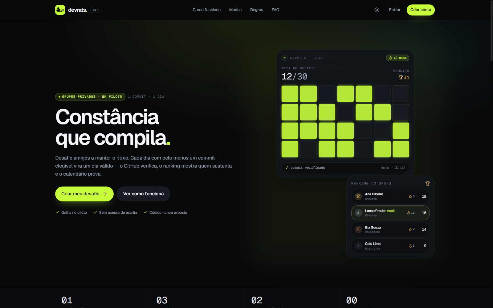

<div align="center">

# DevRats Web 🎯

**Frontend React do DevRats — desafios privados de constância para desenvolvedores, com verificação automática de commits no GitHub, ranking, sequência e calendário de dias válidos.**

[](https://github.com/felipevenas/webapp-dev-rats/actions/workflows/ci.yml)
[](https://react.dev/)
[](https://www.typescriptlang.org/)
[](https://vite.dev/)
[](https://tailwindcss.com/)
[](https://vitest.dev/)
[](https://oxc.rs/)
[](#-governança-e-comunidade)
[](LICENSE)

<br />

<p align="center">
  <a href="#stack"><b>Stack</b></a> •
  <a href="#como-rodar"><b>Executar Local</b></a> •
  <a href="#scripts"><b>Scripts</b></a> •
  <a href="#arquitetura"><b>Arquitetura</b></a> •
  <a href="#rotas"><b>Rotas</b></a> •
  <a href="#testes"><b>Testes</b></a> •
  <a href="#-governança-e-comunidade"><b>Governança</b></a>
</p>

</div>

---

Frontend do **DevRats**, a plataforma de constância para desenvolvedores: desafios privados, verificação automática de commits no GitHub, ranking, sequência e calendário de dias válidos.

Este repositório entrega o **MVP navegável** descrito em [`docs/PRD-MVD.md`](docs/PRD-MVD.md), integrado à API Spring Boot em [`../api-dev-rats`](../api-dev-rats).



> Landing pública em tema escuro. O painel autenticado depende da API em execução; os fluxos completos estão descritos em [Rotas](#rotas).

## Stack

- React 19 + TypeScript + Vite
- Tailwind CSS v4 com tokens semânticos (dark-first + tema claro)
- React Router 7 com rotas lazy
- TanStack Query para estado de servidor
- React Hook Form + Zod para formulários
- Radix UI para primitivas acessíveis (dialog, dropdown, tooltip, switch, checkbox)
- Lucide + marca própria
- Vitest para regras puras

## Requisitos

- **Node.js >= 22** (validado com Node 24.11).
- **npm >= 10**.
- API Spring Boot (`../api-dev-rats`) e PostgreSQL em execução para os fluxos autenticados.

## Como rodar

```powershell
npm install
npm run dev
```

A aplicação sobe em **http://localhost:5174**. A porta 5173 é evitada porque outro projeto local costuma ocupá-la.

Em desenvolvimento o Vite faz proxy de `/api` para `http://localhost:8080`; isso mantém o cookie HttpOnly de refresh na mesma origem e dispensa CORS no navegador. Para apontar para outra API:

```powershell
# .env.local
VITE_API_BASE_URL=https://api.seu-dominio.com/api/v1
```

### API local

```powershell
cd ../api-dev-rats
$env:JAVA_HOME='C:\Program Files\Eclipse Adoptium\jdk-25.0.5.8-hotspot'
$env:SPRING_PROFILES_ACTIVE='local'
$env:APP_FRONTEND_URL='http://localhost:5174'
$env:APP_CORS_ALLOWED_ORIGINS='http://localhost:5173,http://localhost:5174'
.\mvnw.cmd spring-boot:run
```

O backend precisa de `APP_FRONTEND_URL` apontando para a origem do frontend por causa dos redirects do OAuth do GitHub. Em produção, frontend e API devem estar no mesmo site (subdomínios do mesmo domínio ou proxy), pois o refresh cookie é `SameSite=Strict` e restrito a `/api/v1/auth`.

> O preview público de convite (`GET /api/v1/invites/{token}`) foi liberado no `SecurityConfig` da API. Sem essa regra, a página `/invites/:token` não abre para visitantes deslogados, embora o controller não exija autenticação.

## Scripts

| Comando | Função |
|---|---|
| `npm run dev` | Servidor de desenvolvimento em `:5174` |
| `npm run build` | Typecheck + build de produção |
| `npm run preview` | Preview do build |
| `npm test` | Testes unitários (Vitest) |
| `npm run lint` | oxlint |
| `npm run typecheck` | Verificação de tipos |

## Arquitetura

Organização **feature-based** com separação de responsabilidades por feature:

```text
src/
├── app/              providers, router, layout raiz, query client
├── components/
│   ├── brand/        logo, marca GitHub, visual de streak
│   ├── feedback/     splash, toaster, progresso de navegação
│   ├── layout/       AppShell, sidebar, bottom nav, page header
│   └── ui/           design system (botões, cards, modais, campos, anel…)
├── core/
│   ├── auth/          sessão em memória, guardas de rota
│   ├── config/        env, query keys
│   ├── http/          axios, refresh single-flight, parser RFC 9457
│   ├── lib/           datas/fuso, formatação, tema, utilitários
│   └── types/         contratos da API e tipos de UI
├── features/
│   ├── auth/          login, cadastro, recuperação, schemas
│   ├── landing/       página pública
│   ├── onboarding/    checklist de conexão
│   ├── dashboard/     painel e cards de desafio
│   ├── challenges/    wizard de criação, regras e status
│   ├── groups/        detalhe do grupo, ranking, configurações, convites
│   ├── progress/      leaderboard, calendário, feed, resultado
│   ├── github/        integração e repositórios
│   ├── invites/       página pública de convite
│   ├── notifications/ central de alertas
│   ├── profile/       perfil, preferências, exportação e exclusão
│   ├── legal/         termos e privacidade
│   └── errors/        404, 403 e error boundary
├── styles/            tokens, base e utilitários
└── tests/             suporte e testes transversais
```

Cada feature usa `domain` (regras e tipos), `data` (API + hooks) e `ui` (apresentação). O objetivo é manter dependências em uma direção só, sem camadas cerimoniais: `ui → data → domain`, com o design system e o core compartilhados.

### Sessão

- O access token JWT fica **apenas em memória**.
- O refresh token fica em cookie HttpOnly definido pela API.
- No boot, o app tenta `POST /auth/refresh`; qualquer 401 em uma requisição protegida dispara um refresh single-flight e repete a requisição original.
- Rotas protegidas usam `RequireAuth` com `next=` preservado; rotas de autenticação usam `RequireAnonymous`.

## Rotas

| Rota | Tela |
|---|---|
| `/` | Landing |
| `/login`, `/register`, `/forgot-password`, `/reset-password` | Autenticação |
| `/onboarding` | Conectar GitHub e criar o primeiro desafio |
| `/invites/:token` | Convite público + aceite |
| `/app` | Dashboard |
| `/app/challenges` | Lista e filtros de desafios |
| `/app/groups/new` | Wizard de criação (grupo → regras → janela → repositórios → revisão) |
| `/app/groups/:id` | Desafio: visão geral, ranking, calendário e atividade |
| `/app/groups/:id/settings` | Grupo, membros, convites e zona de risco |
| `/app/notifications` | Alertas |
| `/app/profile` | Perfil, preferências e dados |
| `/app/settings/integrations` | Integração GitHub e repositórios |
| `/termos`, `/privacidade` | Documentos legais |

## Responsividade

Testado com Playwright em **320, 360, 390, 768, 1024, 1280 e 1440px**, em tema claro e escuro, cobrindo landing, autenticação, convite público, dashboard, desafios, wizard, grupo, ranking, calendário, atividade, configurações, perfil, integrações, alertas, modais e estados de erro.

Decisões relevantes:

- Sidebar a partir de `lg`; bottom nav abaixo disso, com FAB central de criação.
- Telas editoriais (wizard e configurações do grupo) escondem a bottom nav no mobile para liberar o formulário e evitam sobreposição do CTA fixo.
- Layouts de duas colunas (main + rail) só a partir de `xl`, porque a sidebar consome 240px em `lg`.
- Filtros viram `select` nativo abaixo de `sm`; tabs do desafio usam grade de 4 colunas no mobile.
- Calendário com largura limitada e breakpoint em `md` para evitar células gigantes em tablet.
- Cards, grids e textos longos usam `min-w-0` para impedir blowout horizontal.
- Modais viram bottom sheets no mobile, com primária no rodapé e foco preso pelo Radix.
- Botões não quebram linha; ações com muito texto podem rolar/encurtar em vez de estourar.
- Tema claro/escuro disponível na top bar mobile, na sidebar desktop, na landing e nas telas de autenticação.

O relatório detalhado está em [`docs/RESPONSIVE-QA.md`](docs/RESPONSIVE-QA.md).

## Acessibilidade

- Tokens com contraste AA nos dois temas; foco visível em todos os controles.
- Labels associados, `aria-invalid`, erros anunciados e descrições de dia no calendário.
- Calendário navegável por teclado (setas) com roving tabindex.
- `prefers-reduced-motion` respeitado globalmente.
- Botões de ícone com `aria-label`; bottom nav com `aria-current`.
- Toasts em `aria-live` via Sonner.

## Testes

```powershell
npm test
```

Cobrem regras puras críticas: grade de calendário e fuso horário, contagem de dias, política de senha espelhada do backend, validação do wizard (meta, datas, repositórios) e limites de contrato.

O CI roda em Node 22 e 24 com `npm ci`, lint, typecheck, testes e build. Pull Requests devem manter todos os gates verdes e atualizar o changelog quando a mudança for relevante ao usuário.

## Limitações conhecidas

- O modo **repositórios selecionados** exige uma GitHub App configurada no backend; sem credenciais a UI mostra o estado honesto de integração indisponível.
- O feed da API é agregado por grupo e não traz o autor do evento; a interface o apresenta como “Atividade do desafio”.
- A API não reexibe o token de um convite já criado: o link completo deve ser copiado no momento da geração.
- A API não possui caixa de convites recebidos; a entrada acontece exclusivamente por link.
- O avatar é o do GitHub ou iniciais; não há upload no MVP.
- O build emite aviso de tamanho do chunk principal (vendor). Rotas já são lazy; um split manual de vendor pode ser adicionado quando o app crescer.

---

## 🤝 Governança e Comunidade

Este repositório segue uma governança formal, espelhando a dos demais projetos do autor:

| Documento | Finalidade |
|---|---|
| [`CONTRIBUTING.md`](CONTRIBUTING.md) | Fluxo de branches/commits, diretrizes arquiteturais e como rodar os gates. |
| [`CODE_OF_CONDUCT.md`](CODE_OF_CONDUCT.md) | Código de conduta da comunidade. |
| [`SECURITY.md`](SECURITY.md) | Política de divulgação responsável e escopo de segurança do frontend. |
| [`CHANGELOG.md`](CHANGELOG.md) | Histórico de versões ([Keep a Changelog](https://keepachangelog.com/pt-BR/1.1.0/) + SemVer). |
| [`LICENSE`](LICENSE) | Licença proprietária. |
| [`.github/`](.github) | Templates de Issue/PR e workflows de **CI** (lint, tipos, Vitest e build) e **labels**. |
| [`.editorconfig`](.editorconfig) · [`.gitattributes`](.gitattributes) | Padronização de estilo, finais de linha LF e normalização de binários. |

---

## Documentação relacionada

- [`docs/PRD-MVD.md`](docs/PRD-MVD.md) — PRD do MVP e regras de produto.
- [`docs/RESPONSIVE-QA.md`](docs/RESPONSIVE-QA.md) — auditoria de responsividade com Playwright.
- [`../api-dev-rats`](../api-dev-rats) — API Spring Boot que serve este frontend.

---

## 📄 Licença

Software **proprietário** — todos os direitos reservados. Consulte o arquivo [`LICENSE`](LICENSE) para os termos completos.

<div align="center">
Desenvolvido com excelência por <b><a href="https://github.com/felipevenas">Felipe Venas</a></b>
</div>
